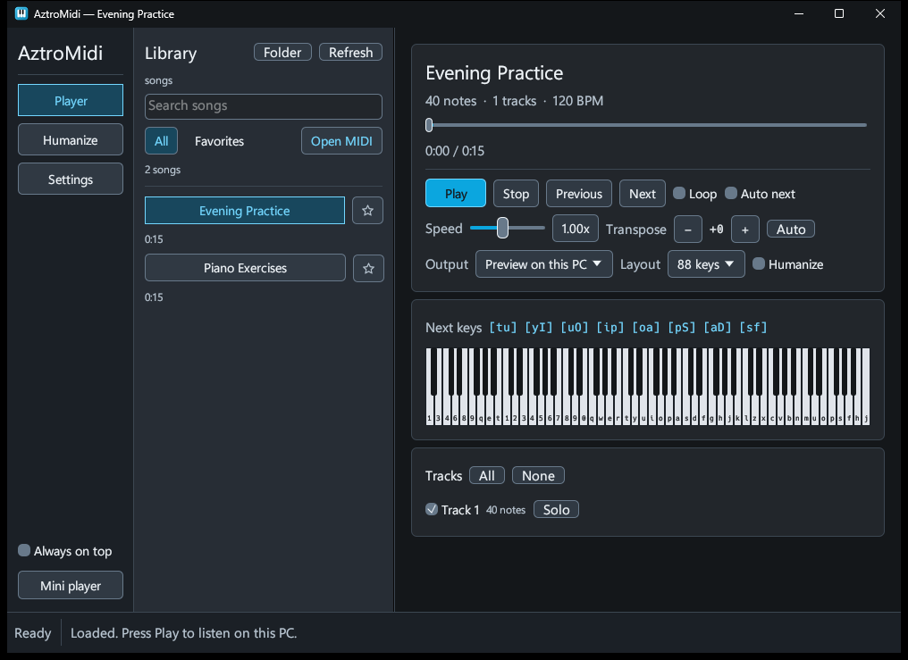
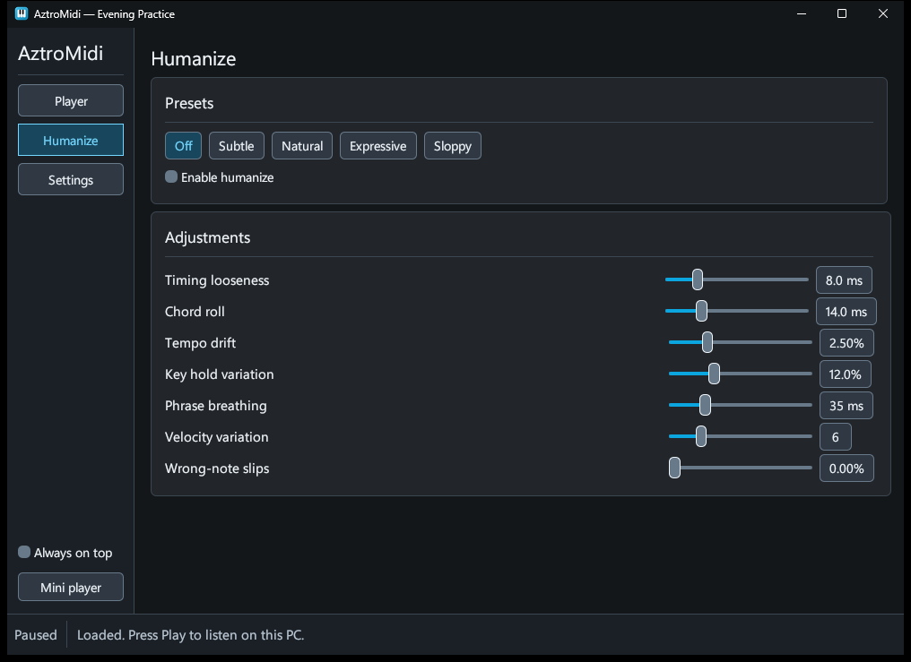
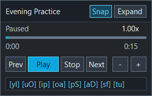

<p align="center">
  
</p>

<h1 align="center">AztroMidi</h1>

<p align="center">A Windows MIDI player for Roblox pianos.</p>

<p align="center">
  <a href="https://github.com/Ayzmi/AztroMidi/releases">Downloads</a>
  · <a href="#quick-start">Quick start</a>
  · <a href="#build-from-source">Build from source</a>
  · <a href="LICENSE">MIT License</a>
</p>

<p align="center">
  
</p>

## Quick start

1. Get the standalone Windows x64 executable from [Releases](https://github.com/Ayzmi/AztroMidi/releases), or [build it from source](#build-from-source).
2. Choose a MIDI folder in **Library** or drop a file onto the window. Dropped files move into the library by default. **Settings → Library → Dropped files** also lets you copy them or only add them to the list.
3. Select a song. Choose **Preview on this PC** to listen through your speakers, or choose **Roblox**, open a compatible piano in the game, and press **Play**.
4. Press **F7** to open the mini player.

Keyboard playback waits when Roblox loses focus and resumes when you switch back. Press **F1** to return to Roblox while playback is waiting. If black keys are missed in game, check that Shift Lock is off.

## Playback and library

- Play on the standard **61-key layout** or the **88-key layout** on pianos that support the Ctrl extension.
- Follow MIDI tempo changes, adjust speed from 0.25× to 2×, and transpose notes to fit the keyboard.
- Solo or mute tracks, follow the sustain pedal, and use velocity keys on supported pianos.
- Search your library, keep favorites, and loop a song or continue to the next one.
- See which keys are playing and which notes are coming up. Selecting another song during playback keeps the current song going until you double-click or press **Enter**.

AztroMidi looks for a `songs` folder beside the executable by default and saves portable preferences in `settings.json`.

## Humanize

Start with a preset or adjust timing, chord roll, tempo drift, note length, velocity, and pauses between phrases. Choose **Off** when you want the original timing.



## Mini player

The mini player shows progress, speed, and the next keys without taking focus away from the game. Snap it to the top-right of the Roblox window or drag it where you want it.



## Default hotkeys

| Key | Action |
| --- | --- |
| F1 | Play or pause. Return to Roblox if playback is waiting for focus. |
| F2 | Stop |
| F3 / F4 | Slow down or speed up |
| F5 | Next song |
| F6 | Toggle Humanize |
| F7 | Toggle the mini player |

Change global hotkeys in **Settings**. Inside AztroMidi, **Ctrl+O** opens MIDI files, **Ctrl+F** searches the library, and **Space** plays or pauses.

## Build from source

You’ll need Windows 10 or 11 x64, [Rust stable with the MSVC toolchain](https://rustup.rs/), and Visual Studio Build Tools with the **Desktop development with C++** workload.

```powershell
cargo run --locked
cargo test --locked
.\build.ps1
```

The build script writes the standalone executable to `dist\latest\AztroMidi.exe`.

See [CONTRIBUTING.md](CONTRIBUTING.md) for development notes and [CHANGELOG.md](CHANGELOG.md) for project updates. AztroMidi is [MIT-licensed](LICENSE) and inspired by [MIDI++](https://github.com/Zephkek/MIDIPlusPlus).
